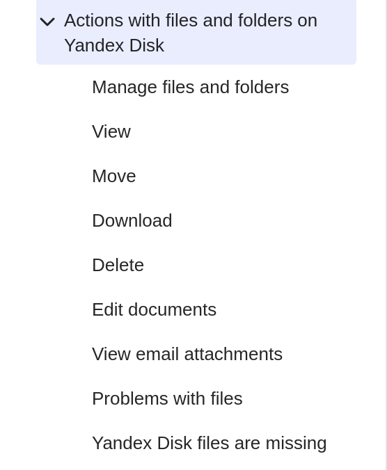
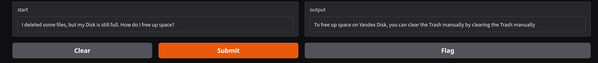
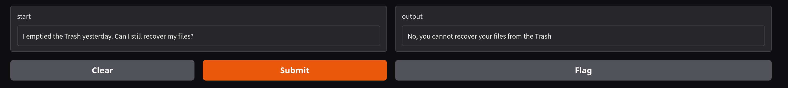
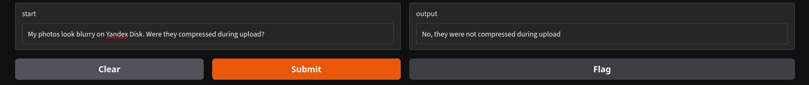
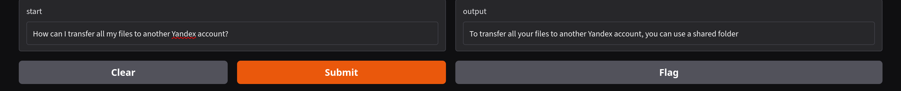
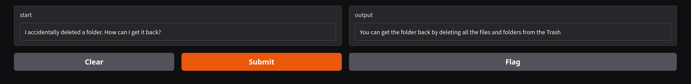
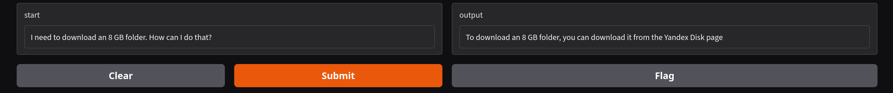

## ГПТ2 как бот поддержки яндекс диска

из информации для ответов возьмем https://yandex.com/support/yandex-360/customers/disk/web/en/file-features-index

и только раздел 



для простоты

### Выбор модели

для теста у меня будет базовый промпт:

```
Below is an instruction that describes a task. Write a response that appropriately completes the request.

### Instruction:

Look for answers to your questions in the documentation and don't invent anything unnecessary. Try to answer politely.

Documentation:
Files permanently removed from the Trash cannot be recovered.
To restore a file still in the Trash, open the Trash, select the file, and click Restore.

Question:
I emptied the Trash. Can I recover my presentation?

### Response:
```

Давайте попробуем для начала запустить гпт2 на 124M параметров

```
Below is an instruction that describes a task. Write a response that appropriately completes the request.

### Instruction:

Look for answers to your questions in the documentation and don't invent anything unnecessary. Try to answer politely.

Documentation:
Files permanently removed from the Trash cannot be recovered.
To restore a file still in the Trash, open the Trash, select the file, and click Restore.

Question:
I emptied the Trash. Can I recover my presentation?

### Response:


I've been asked to restore the presentation. I've been told that the presentation is not available. I've also been told that the presentation is not available.
```
как мы видим ему не очень хорошо

поэтому я сразу перейду на дообученную модель LaMini-GPT-124M (https://huggingface.co/MBZUAI/LaMini-GPT-124M)

(попыток что-то сделать на обычной гпт2 было много...)

```
This model is one of our LaMini-LM model series in paper "LaMini-LM: A Diverse Herd of Distilled Models from Large-Scale Instructions". This model is a fine-tuned version of gpt2 on LaMini-instruction dataset that contains 2.58M samples for instruction fine-tuning. For more information about our dataset, please refer to our project repository.
```

она позволит лучше выполнять задачу

давайте посмотрим как она выполнит запрос:

```
Below is an instruction that describes a task. Write a response that appropriately completes the request.

### Instruction:

Look for answers to your questions in the documentation and don't invent anything unnecessary. Try to answer politely.

Documentation:
Files permanently removed from the Trash cannot be recovered.
To restore a file still in the Trash, open the Trash, select the file, and click Restore.

Question:
I emptied the Trash. Can I recover my presentation?

### Response:
```

```
No, you cannot recover your presentation if you have emptied the trash
```

хороший ответ

### Проблема с размером документации

у Яндекс диска слишком большая документация, и она не влезет в промпт и модель забудет и будет нести странные вещи.

в этом случае давайте порежем документацию на куски по $n$ слов и будем каким-то поиском искать наиболее полезные

### Сематический поиск

воспользуемся https://www.sbert.net/examples/sentence_transformer/applications/semantic-search/README.html

```
Semantic search seeks to improve search accuracy by understanding the semantic meaning of the search query and the corpus to search over. Semantic search can also perform well given synonyms, abbreviations, and misspellings, unlike keyword search engines that can only find documents based on lexical matches.
```

### провал

```
### Instruction:

Look for answers to your questions in the documentation and don't invent anything unnecessary. Try to answer politely.
And if you don't find this in the documentation, write: "I didn't find it in the documentation."
Documentation:
be restored. If your files were deleted less than a month ago, you can restore them: 1. Open the Trash. 2. Select the files you
restore. 3. In the top panel, click Restore. Alert Once files are deleted from the Trash (automatically or manually), we can't recover them: emptying the
restore deleted files and folders only if they're still in the Trash. 1. Open the Trash. 2. Choose the files or folders you want to

Question:
I emptied the Trash. Can I recover my presentation?

```

```
Yes, you can recover your presentation if you emptied the Trash
```

если делить по словам то что-то странное получается, заметим что абзацы в яндекс диске не прям большие и делить можно по ним

### попытка 2

теперь делим по абзацам

посмотрим что вышло:
```
Below is an instruction that describes a task. Write a response that appropriately completes the request.

### Instruction:

Look for answers to your questions in the documentation and don't invent anything unnecessary. 

Documentation:
Delete files and folders
Restore files and folders from the Trash
You can restore deleted files and folders only if they're still in the Trash.
1. Open the Trash.
2. Choose the files or folders you want to restore.
3. In the top panel, click Restore.
Alert
Once files are deleted from the Trash (automatically or manually), we can't recover them: emptying the Trash permanently deletes its contents from Yandex's servers.
Download
Downloading all files from Yandex Disk
Restore files from the Trash
1. Open the Yandex Disk page.
2. Go to Trash.
3. Choose the files or folders you want to restore.
4. In the top panel, click Restore.

Question:
I emptied the Trash. Can I recover my presentation?

### Response

No, you cannot recover your presentation from the Trash
```

удовлетворительно

### Файлы

подготовленная документация я.диска лежит в docs.txt

сем поиск в couple.py

генерация ответа в gen.py, а итоговая генерация в runner.py

графическое взаимодействие через градио app.py


### Немного тестов

"успехи"







провалы



### Возможные решения проблем
- увеличение модели, есть модель на 774M
- сделать сематический поиск умнее, лучше нарезать на куски
- поменять промпт
- дообучение


### инструкция по запуску

```
git clone https://github.com/scipsy0-0/support-nano-GPT.git
cd support-nano-GPT
pip install -r requirements.txt
python app.py
```